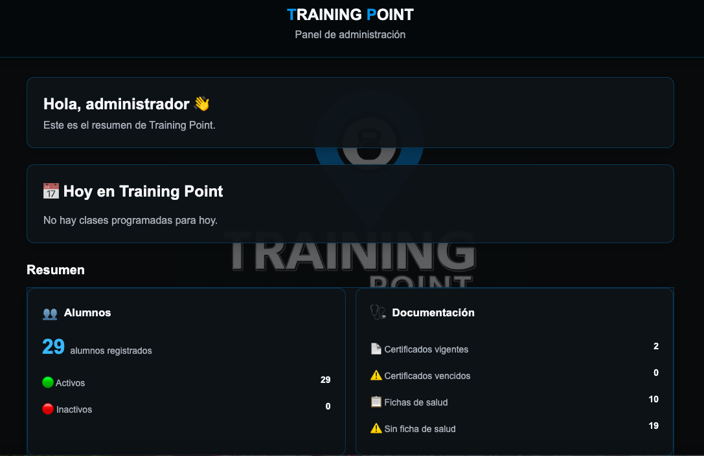
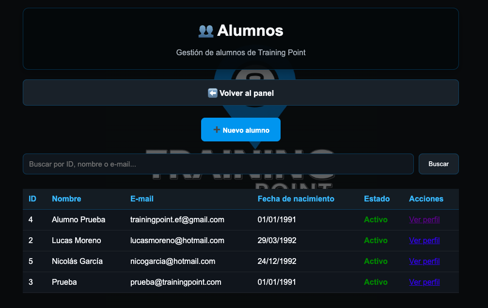
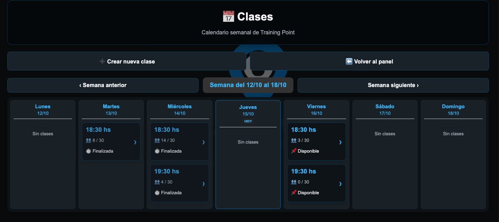
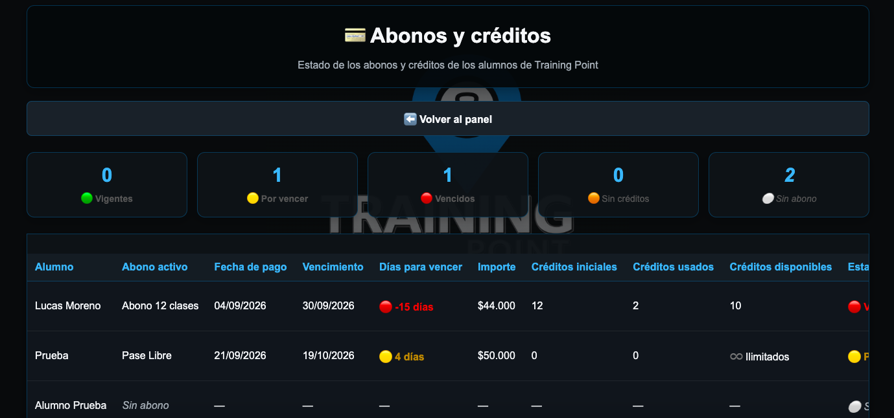
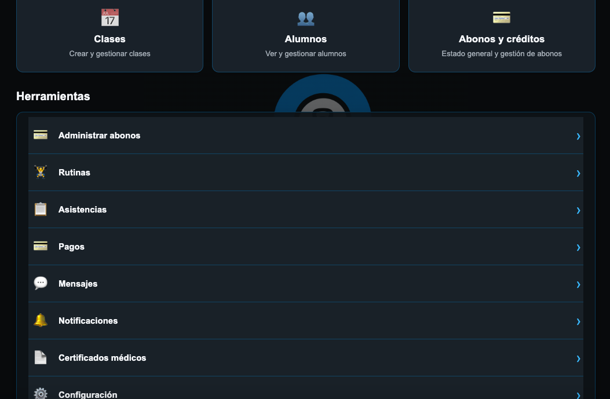

# TrainingPointManager

### Sistema web de gestión para centros de entrenamiento

TrainingPointManager es una aplicación web desarrollada con Python, Flask y SQLite para digitalizar y simplificar la administración de Training Point, un emprendimiento real de entrenamiento funcional.

El proyecto surge de la necesidad de organizar alumnos, clases, inscripciones, asistencias y abonos en un único sistema.

## Tecnologías utilizadas

- Python
- Flask
- SQLite
- HTML y CSS
- Git y GitHub

## Funcionalidades principales

- Registro y administración de alumnos.
- Autenticación de usuarios con roles de administrador y alumno.
- Creación y administración de clases.
- Inscripciones y control de cupos.
- Registro de asistencias mediante códigos QR.
- Gestión de abonos y créditos.
- Consulta y administración de pagos.
- Notificaciones y comunicación con alumnos.
- Configuración de horarios y parámetros generales.

## Capturas de pantalla

### Panel de administración
Vista general del sistema con indicadores de alumnos, documentación y actividad administrativa.



### Gestión de alumnos
Listado de alumnos, búsqueda y acceso a sus perfiles.



### Calendario de clases
Organización semanal de clases, horarios, inscripciones, cupos y estados.



### Gestión de abonos y créditos
Seguimiento de abonos, vencimientos y créditos disponibles.



### Herramientas administrativas
Acceso a los diferentes módulos de gestión de TrainingPointManager.




## Estructura del proyecto

- `app.py`: lógica principal y rutas de la aplicación.
- `database.py`: gestión e inicialización de la base de datos.
- `templates/`: interfaces HTML.
- `static/`: estilos y recursos visuales.
- `requirements.txt`: dependencias de Python.

## Instalación local

Clonar el repositorio:

```bash
git clone https://github.com/damiandemiguel/TrainingPointManager.git
cd TrainingPointManager
```

Crear y activar un entorno virtual:

```bash
python3 -m venv .venv
source .venv/bin/activate
```

Instalar las dependencias:

```bash
pip install -r requirements.txt
```

La aplicación requiere configurar las variables de entorno y preparar la base de datos antes de ejecutarse. Las instrucciones específicas de configuración se incorporarán una vez verificado el proceso completo.

## Estado del proyecto

Proyecto en desarrollo activo. Las funcionalidades se amplían y mejoran progresivamente según las necesidades reales de Training Point.

## Próximas mejoras

- Ampliación de funcionalidades administrativas.
- Mejoras de interfaz y experiencia de usuario.
- Automatización de procesos de gestión.
- Incorporación de nuevas herramientas de análisis y reportes.

## Autor

**Damián de Miguel**

Desarrollador en formación, orientado a Python, automatización de procesos y análisis de datos.

GitHub: https://github.com/damiandemiguel
